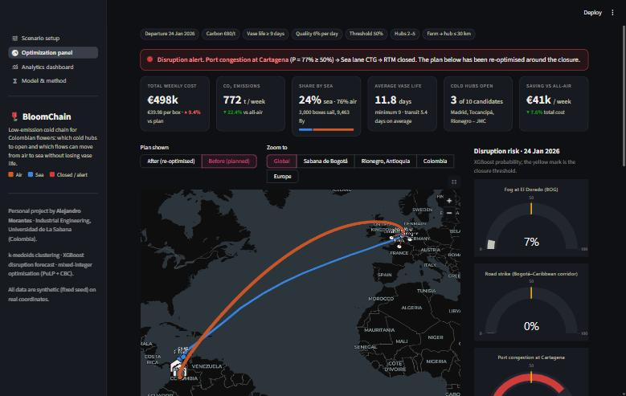

# BloomChain – Low-emission cold chain for Colombian flowers

Personal project by Alejandro Morantes (Industrial Engineering, Universidad de La Sabana).



## Problem
Flower farms in the Sabana de Bogotá and Rionegro (Antioquia) export roses, carnations and chrysanthemums to Europe, almost entirely by air. BloomChain decides which refrigerated consolidation hubs to open, which flows travel by air or in reefer containers by sea, and which European chain takes each box to the customer, balancing cost, CO₂, transit time and vase life. All data are synthetic (fixed seed) on real, approximate coordinates.

The destination market is a parameter on the first page:

| Market | Customers | Transatlantic lanes | European chains |
|---|---|---|---|
| Netherlands | Aalsmeer, Naaldwijk, Rijnsburg auctions | BOG/MDE → Schiphol, CTG/SMR → Rotterdam | truck, barge to Alphen + truck |
| France | Paris-Rungis, Lyon, Marseille | + BOG → Paris-CDG, CTG → Le Havre, SMR → Fos | Seine barge, rail, Rhône barge, truck |
| Switzerland | Zurich, Basel, Geneva | + SMR → Genoa | Rhine barge to Basel, rail through the Gotthard, connecting flight to Zurich, truck |
| Sweden | Stockholm, Gothenburg, Malmö | Schiphol, Rotterdam | feeder ship to Gothenburg + rail, connecting flight to Arlanda, truck over the Danish bridges |
| Finland | Helsinki, Tampere, Turku | Schiphol, Rotterdam | feeder ship to Vuosaari, truck + Travemünde–Helsinki ferry, connecting flight |

Each market's weekly order comes from its size: population × yearly spending on cut flowers per person × 2.6 boxes per € million (the Dutch auctions, which re-export, take 88% of the farms' supply).

## Method
1. **k-medoids (PAM, written by hand)** clusters the 40 farms per region; k is chosen by silhouette and compared with k-means. Medoids are real farms and become candidate hub sites.
2. **XGBoost** (one binary classifier per disruption: fog at BOG, road strike, port congestion, Atlantic storm), temporal split: 2 years to train, 12 months to test.
3. **Mixed-integer model (PuLP + CBC)**, compared with the ADD and DROP greedy heuristics. If $\hat{P}(\text{disruption}) \ge \tau$ the lane or arc is closed ($z = 0$) and the plan is re-optimised.

## Mathematical formulation
Sets: farms $F$, candidate hubs $H$, lanes $L$, European chains $E$ (each chain $e$ leaves the arrival node of a lane and ends at one customer $d(e)$), customers $D$ of the chosen market, flowers $P$. Variables: $y_h \in \{0,1\}$ open hub; $m_l \in \{0,1\}$ activate lane; $x_{fhp} \ge 0$ boxes farm → hub; $w_{hlep} \ge 0$ boxes from hub $h$ via lane $l$ and European chain $e$; $v_{lp}, u_{ldp} \ge 0$ lane and arrival → destination flows; $s_{dp} \ge 0$ demand not delivered; $z$ availability fixed by the forecast.

$$
\min \sum_h F_h y_h + \sum_l G_l m_l + \sum_{f,h,p} (c_{fh} + \pi g_{fh} + q_p \delta_{fh})\, x_{fhp} + \sum_{h,l,e,p} (c_{hle} + \pi g_{hle} + q_p \delta_{hle})\, w_{hlep} + M \sum_{d,p} s_{dp}
$$

subject to

$$
\begin{aligned}
&\textstyle\sum_h x_{fhp} \le S_{fp} && \text{farm supply}\
&\textstyle\sum_f x_{fhp} = \sum_{l,e} w_{hlep} && \text{flow balance at each hub}\
&\textstyle\sum_{h,e} w_{hlep} = v_{lp} = \sum_d u_{ldp}, \quad u_{ldp} = \sum_h \sum_{e:\, d(e)=d} w_{hlep} && \text{balance at gateway and arrival node}\
&\textstyle\sum_l u_{ldp} + s_{dp} = D_{dp} && \text{demand}\
&\textstyle\sum_{f,p} x_{fhp} \le K_h y_h && \text{hub capacity}\
&\textstyle\sum_p v_{lp} \le Q_l m_l z_l && \text{flow only on active, available lanes}\
&w_{hlep} = 0 \ \text{if } z_{hl} = 0 \ \text{or } V_p - \delta_{hle} - \delta_h^{\max} < V^{\min} && \text{closures and minimum vase life}\
&x_{fhp} = 0 \ \text{if } \mathrm{dist}_{fh} > R && \text{maximum farm–hub distance}\
&N^{\min} \le \textstyle\sum_h y_h \le N^{\max}, \quad y_h + y_{h'} \le 1 \ \text{if } \mathrm{dist}_{hh'} < G^{\min} && \text{number and spacing of hubs}
\end{aligned}
$$

$c$ = € per box, $g$ = kg CO₂ per box, $\pi$ = carbon price, $\delta$ = vase-life days lost, $q_p$ = € lost per box and vase-life day.

## Run it
```bash
pip install -r requirements.txt
python data/generate_data.py
python ml/train_xgboost.py
streamlit run app.py
```
Tested with Python 3.13 (the pinned versions also support 3.11). The CSV files and trained models are already in the repository; the two scripts only regenerate them.

## Deploy for free on Streamlit Community Cloud
1. Push this folder to a public GitHub repository.
2. Go to share.streamlit.io, sign in with GitHub and choose **Create app**.
3. Select the repository, branch `main` and main file `app.py`, then **Deploy**.

## Structure
`app.py` · `pages/` · `data/` · `ml/` · `optimization/` · `models/` · `utils/` · `assets/` · `.streamlit/config.toml`
